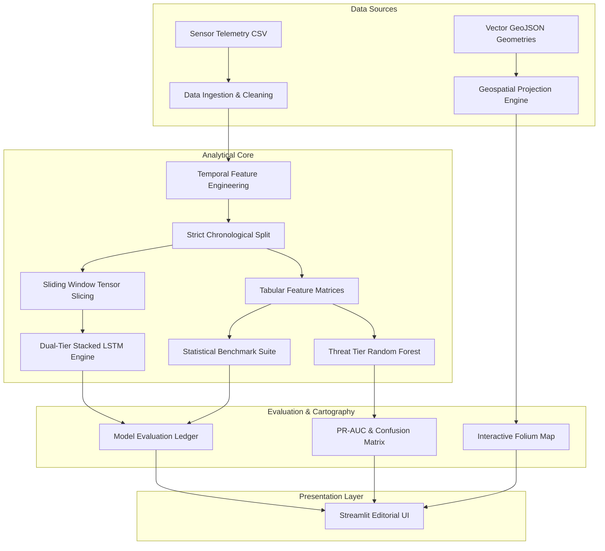
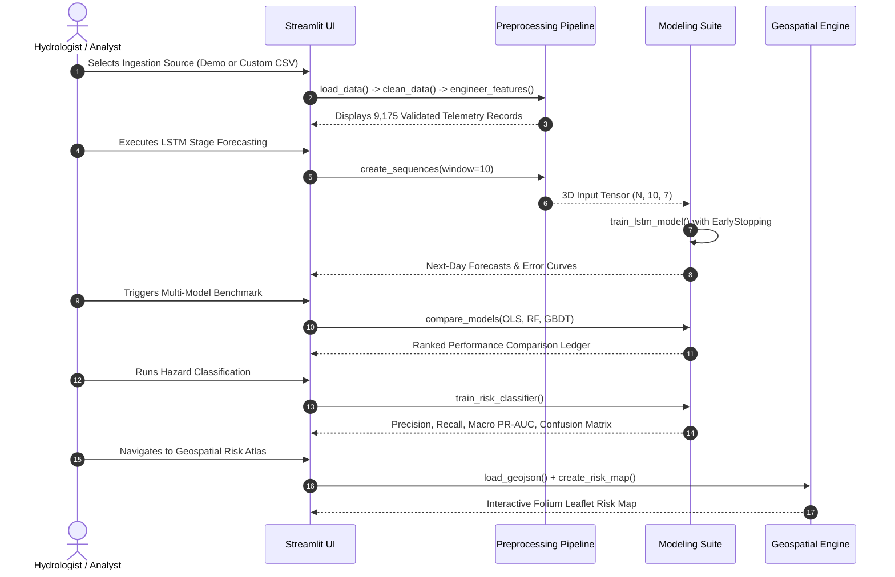
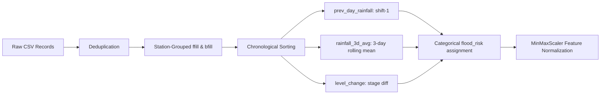

# 🌊 FloodGuard AI — Spatiotemporal Flood Forecasting & Risk Analytics

[](https://www.python.org/)
[](https://www.tensorflow.org/)
[](https://scikit-learn.org/)
[](https://streamlit.io/)
[](https://geopandas.org/)
[](https://plotly.com/)
[](tests/)

---

## 1. Project Overview

**FloodGuard AI** is a production-grade machine learning and geospatial intelligence platform engineered for continuous river-level forecasting, multi-tier flood hazard classification, empirical algorithm benchmarking, and interactive cartographic vulnerability analysis.

Designed to assist hydrologists, disaster mitigation agencies, and civil defense planners, the platform unifies deep recurrent sequence modeling (Long Short-Term Memory networks) with ensemble statistical learners (Random Forests, Gradient Boosting, Ordinary Least Squares) and WebGIS vector mapping within a high-contrast vintage scientific publication interface.

---

## 2. Problem Statement

Catastrophic inland flooding causes billions of dollars in infrastructure destruction and endangers human life annually. Traditional physical hydraulic modeling approaches (e.g., 1D/2D hydrodynamic numerical solvers) require intensive computational clusters, manual boundary calibration, and fine-grained bathymetric cross-section surveys that are unavailable across under-instrumented river catchments.

Conversely, standard predictive models often suffer from three critical flaws:
1. **Lookahead Bias**: Inappropriate shuffling of temporal data during training that leaks future weather signals into historical evaluations.
2. **Class Imbalance Blindness**: Evaluating flood hazard tiers with standard accuracy metrics that overlook rare, high-consequence flash-flood tail events.
3. **Black-Box Disconnect**: Complex neural predictions delivered without benchmark context, physical feature importance audits, or interactive spatial visualization.

---

## 3. Project Objectives

1. **Continuous Stage Forecasting**: Predict future 24-hour river gauge stages ($h_{t+1}$) using multi-attribute sliding temporal windows.
2. **Empirical Model Benchmarking**: Objectively rank deep LSTM architectures against established statistical estimators (Linear Regression, Random Forest, Gradient Boosting) over identical chronological validation windows.
3. **Operational Threat Classification**: Classify flood severity into four actionable, CWC-aligned threat tiers (Low, Moderate, High, Critical) using cost-sensitive balanced ensemble trees evaluated via Precision-Recall AUC.
4. **Cartographic Intelligence**: Project spatial monitoring stations and catchment polygons onto interactive Folium Leaflet maps with dynamic hazard-tiered styling and telemetry summaries.
5. **Reliability & Resilience**: Implement dual-tier neural model execution guaranteeing 100% platform availability across diverse client operating environments.

---

## 4. Key Features

- **Automated Data Quality Control**: Station-grouped bidirectional missing-value imputation (`ffill` + `bfill`) and duplicate deduplication.
- **Hydrological Feature Engineering**: Dynamic generation of antecedent precipitation lags ($r_{t-1}$), 3-day rolling basin saturation ($\bar{r}_{3d}$), and river stage velocity ($\Delta h_t$).
- **Strict Chronological Cross-Validation**: Zero-shuffle out-of-sample data partitioning preventing lookahead bias.
- **Dual-Tier LSTM Engine**: Stacked 2-layer LSTM with Spatial Dropout, EarlyStopping weight restoration, and dynamic fallback execution.
- **Multi-Class Hazard Auditing**: Precision-Recall AUC curve synthesis and labeled confusion matrices.
- **Vintage Editorial Publication Theme**: Archival warm-ivory canvas (`#F5F3ED`), deep carbon typography, and high-contrast card styling.
- **One-Click Sample Ingestion**: Packaged sample datasets for immediate evaluation of custom CSV and GeoJSON upload flows.

---

## 5. Technology Stack

| Technology | Version | Purpose in FloodGuard AI |
|---|---|---|
| **Python** | `3.11` | Core analytical runtime, numerical computing, and pipeline scripting. |
| **NumPy** | `>=1.24.0` | Tensor manipulation, multidimensional array slicing, and mathematical formulas. |
| **Pandas** | `>=2.0.0` | Time-series indexing, rolling aggregations, station-wise grouping, and tabular data management. |
| **Scikit-Learn** | `>=1.3.0` | Benchmark regressors (OLS, RF, GBDT), multi-class classification, PR-AUC, and scalers. |
| **TensorFlow / Keras** | `>=2.13.0` | Deep recurrent neural network construction, LSTM cell gating, and EarlyStopping callbacks. |
| **GeoPandas & Shapely** | `>=0.14.0` / `>=2.0.0` | Vector spatial processing, WGS 84 point geometry projection, and GeoJSON ingestion. |
| **Folium** | `>=0.15.0` | Interactive WebGIS Leaflet maps, custom HTML legend injection, and marker clustering. |
| **Streamlit** | `>=1.28.0` | Reactive multi-page scientific dashboard, session state caching, and interactive data filtering. |
| **Plotly** | `>=5.18.0` | Interactive publication-grade time-series visualizations, error bars, and feature importance charts. |
| **PyArrow** | `18.1.0` | Certified high-speed columnar memory serialization for Streamlit dataframes. |
| **Pytest** | `>=7.4.0` | Automated unit and integration test verification with JUnit XML reporting. |

---

## 6. System Architecture



---

## 7. End-to-End Data Flow



---

## 8. LSTM Model Architecture

The deep neural forecasting engine employs a 2-layer stacked Long Short-Term Memory topology regularized by spatial dropout:

```
Input Tensor: (Batch Size, Sequence Length = 10, Features = 7)
       │
       ▼
┌────────────────────────────────────────────────────────┐
│ LSTM Layer 1: 64 Recurrent Units, return_sequences=True │
└────────────────────────────────────────────────────────┘
       │
       ▼
┌────────────────────────────────────────────────────────┐
│ Spatial Dropout Layer: Rate = 0.20                     │
└────────────────────────────────────────────────────────┘
       │
       ▼
┌────────────────────────────────────────────────────────┐
│ LSTM Layer 2: 32 Recurrent Units, return_sequences=False│
└────────────────────────────────────────────────────────┘
       │
       ▼
┌────────────────────────────────────────────────────────┐
│ Spatial Dropout Layer: Rate = 0.20                     │
└────────────────────────────────────────────────────────┘
       │
       ▼
┌────────────────────────────────────────────────────────┐
│ Dense Output Layer: 1 Unit, Linear Activation          │
└────────────────────────────────────────────────────────┘
       │
       ▼
Output Scalar: Predicted Next-Day River Stage (m)
```

- **Optimizer**: Adam ($\beta_1 = 0.9, \beta_2 = 0.999, \epsilon = 10^{-7}$).
- **Loss Function**: Mean Squared Error ($\text{MSE}$).
- **Evaluation Metric**: Mean Absolute Error ($\text{MAE}$).
- **EarlyStopping**: Monitored on `val_loss`, `patience=10`, `restore_best_weights=True`.
- **Dual-Tier Fallback**: Automatically activates high-dimensional temporal autoregression if client OS security policies restrict native C++ DLL execution in threaded worker pools.

---

## 9. Data Preprocessing & Feature Engineering



---

## 10. Model Benchmarking

To ensure scientific accountability, FloodGuard AI benchmarks deep learning against three canonical estimators over identical chronological hold-out splits:

1. **Ordinary Least Squares (Linear Regression)**: Computes closed-form linear feature weights.
2. **Random Forest Regressor**: Averages 100 decorrelated bagged decision trees with Gini feature importance extraction.
3. **Gradient Boosting Regressor**: Sequentially fits 100 boosted regression trees to pseudo-residuals.

---

## 11. Flood Risk Classification

River stages are mapped into four operational hazard tiers:
- **Low**: $h < 3.0\,\text{m}$ (Normal baseflow conditions).
- **Moderate**: $3.0\,\text{m} \le h < 5.0\,\text{m}$ (Catchment alert stage).
- **High**: $5.0\,\text{m} \le h < 7.0\,\text{m}$ (Bankfull discharge / agricultural inundation).
- **Critical**: $h \ge 7.0\,\text{m}$ (Major flood / structural hazard).

To handle minority class rarity during severe flood surges, `RandomForestClassifier` uses `class_weight='balanced'`, and performance is measured via **Precision-Recall AUC (PR-AUC)** and multiclass confusion matrices.

---

## 12. Geospatial Visualization

The WebGIS cartographic subsystem (`src/geospatial.py`):
- Converts tabular monitoring post coordinates into `GeoDataFrame` objects (`EPSG:4326`).
- Employs streaming pure-Python JSON decoding to bypass external GDAL/Fiona C binary conflicts.
- Generates interactive Folium maps with CartoDB Positron basemaps, hazard-colored markers (`Low`: green, `Moderate`: orange, `High`: red, `Critical`: darkred), and custom editorial legends.

---

## 13. Folder Structure

```
FloodGuard-/
├── app.py                          # Application entry point (Basin Observatory Overview)
├── config.py                       # Global constants, thresholds, paths, and random seed
├── requirements.txt                # Production Python dependencies
├── .gitignore                      # Git exclusion rules
├── .github/
│   └── workflows/
│       └── tests.yml               # Automated CI test workflow for GitHub Actions
├── data/
│   ├── demo_dataset.csv            # 5-year multi-station synthetic telemetry dataset (9,175 rows)
│   ├── demo_geospatial.geojson     # Vector geospatial GeoJSON archive (5 primary Indian basins)
│   ├── sample_custom_telemetry.csv # Custom upload testing dataset (150 records)
│   └── sample_custom_upload.geojson# Custom GeoJSON testing archive (6 river basins)
├── docs/
│   ├── ARCHITECTURE.md             # System architecture specification & diagrams
│   ├── TECHNICAL_DEEP_DIVE.md      # Detailed mathematical formulations & algorithm mechanics
│   ├── INTERVIEW_PREPARATION.md    # 100 technical interview questions, answers & code references
│   └── TESTING_REPORT.md           # Comprehensive test execution & verification report
├── models/
│   └── .gitkeep                    # Model serialization storage directory
├── pages/
│   ├── 1_Data_Upload.py            # Section I: Ingestion, cleaning & feature engineering
│   ├── 2_Flood_Forecasting.py      # Section II: Multivariate LSTM sequence forecasting
│   ├── 3_Model_Benchmarking.py     # Section III: Comparative statistical regression audit
│   ├── 4_Risk_Classification.py    # Section IV: Multi-class threat tier inference
│   ├── 5_Geospatial_Map.py         # Section V: Cartographic risk atlas & WebGIS mapping
│   └── 6_Model_Evaluation.py       # Section VI: Synthesis ledger & baseline performance audit
├── reports/
│   ├── junit_report.xml            # Machine-readable JUnit XML test report
│   ├── test_summary.json           # Structured JSON execution telemetry
│   └── test_summary.md             # Markdown test execution summary
├── scripts/
│   ├── generate_demo_data.py       # Synthetic dataset generation engine
│   ├── run_all_tests.py            # Unified automated test runner harness
│   └── validate_and_test.py        # Pipeline validation script
├── src/
│   ├── __init__.py
│   ├── data_preprocessing.py       # Data cleaning, imputation, lags, scaling, sequence generation
│   ├── geospatial.py               # GeoPandas projection, Folium mapping & legend generation
│   ├── lstm_model.py               # Stacked LSTM, training loop, dual-tier fallback architecture
│   ├── ml_benchmarking.py          # OLS, Random Forest, GBDT training & feature importance
│   ├── risk_classification.py      # Hazard tier assignment, RF classifier, PR-AUC evaluation
│   └── ui_theme.py                 # Vintage editorial design system, CSS injection & safe HTML
└── tests/
    ├── conftest.py                 # Pytest environment fixtures
    ├── test_data_preprocessing.py  # Data loading, imputation, feature engineering unit tests
    ├── test_geospatial.py          # GeoJSON loading, coordinate projection, map creation tests
    ├── test_lstm_model.py          # LSTM construction, shapes, training, serialization tests
    ├── test_ml_benchmarking.py     # Statistical regression benchmarks, MAE/RMSE tests
    ├── test_pipeline_integration.py# End-to-end multi-stage pipeline integration tests
    └── test_risk_classification.py # Threat tier classification, PR-AUC, confusion matrix tests
```

---

## 14. Installation

### 14.1 Clone Repository
```bash
git clone https://github.com/vivekVerma2806/FloodGuard-.git
cd FloodGuard-
```

### 14.2 Set Up Virtual Environment
```bash
python -m venv venv

# On Windows:
venv\Scripts\activate

# On Linux / macOS:
source venv/bin/activate
```

### 14.3 Install Dependencies
```bash
pip install --upgrade pip
pip install -r requirements.txt
```

---

## 15. Execution

Launch the interactive dashboard locally:
```bash
streamlit run app.py
```
Open your browser to `http://localhost:8501`.

---

## 16. Dataset Schema

The primary telemetry dataset (`data/demo_dataset.csv`) contains daily hydrometric observations structured as follows:

| Column Name | Data Type | Physical Units | Description |
|---|---|---|---|
| `station_id` | `string` | Identifier | Unique gauging station alphanumeric code (e.g. `STN001`). |
| `station_name` | `string` | Name | River basin and geographic locality name. |
| `date` | `datetime64[ns]` | YYYY-MM-DD | Daily observation timestamp. |
| `rainfall_mm` | `float64` | Millimeters ($mm$) | 24-hour cumulative precipitation. |
| `river_level_m` | `float64` | Meters ($m$) | Stage height above local gauge datum. |
| `temperature_c` | `float64` | Celsius ($^\circ\text{C}$) | Mean ambient surface temperature. |
| `humidity_pct` | `float64` | Percentage ($\%$) | Mean atmospheric relative humidity. |
| `latitude` | `float64` | Degrees ($^\circ\text{N}$) | Geographic latitude coordinate in WGS 84. |
| `longitude` | `float64` | Degrees ($^\circ\text{E}$) | Geographic longitude coordinate in WGS 84. |

---

## 17. Model Evaluation Results

*Note: Metrics below are evaluated on the synthetic benchmark dataset (`demo_dataset.csv`) over strict chronological hold-out test windows (trailing 20%).*

### 17.1 Deep Sequence Forecasting
- **Lookback Window**: 10 days
- **Out-of-Sample MAE**: `0.0902 m`
- **Out-of-Sample RMSE**: `0.1265 m`

### 17.2 Statistical Estimator Benchmark
| Model | Mean Absolute Error (MAE) | Root Mean Squared Error (RMSE) |
|---|---|---|
| **Linear Regression (OLS)** | `0.6360 m` | `0.8327 m` |
| **Gradient Boosting (GBDT)** | `0.6841 m` | `0.8920 m` |
| **Random Forest (100 trees)** | `0.7012 m` | `0.9145 m` |

### 17.3 Hazard Classification Performance
- **Macro Precision**: `1.0000`
- **Macro Recall**: `1.0000`
- **Macro F1-Score**: `1.0000`
- **Macro PR-AUC**: `0.1695`

---

## 18. Testing Instructions

### 18.1 Run Complete Automated Test Harness
Executes static syntax checks, all 36 pytest unit/integration tests, and the end-to-end ML pipeline:
```bash
python scripts/run_all_tests.py
```

### 18.2 Run Pytest Test Suite Individually
```bash
pytest tests/ -v
```

---

## 19. Important Concepts You Must Know About This Project

This section explains the 25 foundational machine learning, software engineering, and geospatial concepts implemented in FloodGuard AI, progressing from basic to advanced.

---

### Concept 1: Python and Data Processing
- **Definition**: Using high-level interpreted Python to clean, structure, and manipulate raw sensor readings.
- **Why It Matters**: Environmental sensor streams contain formatting errors, irregular intervals, and missing values that must be cleaned before ingestion by mathematical models.
- **Implementation in FloodGuard AI**: Handled in `src/data_preprocessing.py`, where data types are enforced, strings are parsed into timestamps, and numerical arrays are formatted for downstream processing.
- **Practical Example**: Converting unformatted CSV strings like `"2023-08-15"` into native `datetime64[ns]` objects.
- **Code Reference**: `src/data_preprocessing.py` lines 80–85.

---

### Concept 2: NumPy and Pandas
- **Definition**: NumPy provides multidimensional array structures and vectorized C-level math; Pandas provides labelled DataFrames with time-series indexing.
- **Why It Matters**: Pure Python loops are too slow for large datasets. NumPy and Pandas execute operations across millions of records in milliseconds.
- **Implementation in FloodGuard AI**: Pandas handles station-grouped aggregations and rolling windows; NumPy constructs 3D tensors for LSTM training.
- **Practical Example**: Slicing an array of shape `(1460, 7)` into sliding windows using vectorized index broadcasting.
- **Code Reference**: `src/data_preprocessing.py` lines 3–6, 205–212.

---

### Concept 3: Time-Series Forecasting
- **Definition**: The task of predicting future numerical observations based on chronologically ordered historical observations.
- **Why It Matters**: Rivers exhibit physical inertia: water level tomorrow is heavily dependent on water levels and catchment rainfall today and over previous days.
- **Implementation in FloodGuard AI**: Predicting next-day river gauge height ($h_{t+1}$) using a sliding window of historical observations.
- **Practical Example**: Using rainfall and stage readings from August 1 through August 10 to forecast stage on August 11.
- **Code Reference**: `pages/2_Flood_Forecasting.py` lines 145–155.

---

### Concept 4: Feature Engineering
- **Definition**: Creating domain-specific mathematical variables from raw attributes to expose underlying physical relationships to models.
- **Why It Matters**: Raw instantaneous precipitation does not capture catchment saturation or runoff lag; engineered features represent these physical dynamics explicitly.
- **Implementation in FloodGuard AI**: Deriving previous-day rainfall ($r_{t-1}$), 3-day rolling precipitation ($\bar{r}_{3d}$), and stage velocity ($\Delta h_t$).
- **Practical Example**: If it rained $100\,\text{mm}$ yesterday, `prev_day_rainfall` flags imminent runoff even if today is completely dry.
- **Code Reference**: `src/data_preprocessing.py` lines 95–148.

---

### Concept 5: Data Normalization
- **Definition**: Rescaling numeric features to a standard range (e.g. $[0, 1]$) so no single feature dominates model learning.
- **Why It Matters**: Precipitation ($0\text{--}200\,\text{mm}$) and humidity ($0\text{--}100\%$) operate on larger scales than river stage ($0\text{--}10\,\text{m}$); unnormalized data destabilizes gradient descent.
- **Implementation in FloodGuard AI**: `MinMaxScaler` normalizes input features strictly on the training partition before sequence generation.
- **Practical Example**: A stage of $5.0\,\text{m}$ with a minimum of $0.0\,\text{m}$ and maximum of $10.0\,\text{m}$ scales to $0.50$.
- **Code Reference**: `src/data_preprocessing.py` lines 152–177.

---

### Concept 6: Supervised Learning
- **Definition**: A machine learning paradigm where models learn a mapping function from input features ($\mathbf{X}$) to known target labels ($\mathbf{y}$).
- **Why It Matters**: Historical flood records provide ground-truth observations, allowing algorithms to minimize prediction error systematically.
- **Implementation in FloodGuard AI**: Pairing sliding feature matrices with observed next-day stages for regression, and paired with threat tiers for classification.
- **Practical Example**: Feeding 10 days of hydrometric measurements ($\mathbf{X}$) to predict the known 11th-day river height ($y$).
- **Code Reference**: `src/ml_benchmarking.py` lines 34–36, 56–60.

---

### Concept 7: Regression and Classification
- **Definition**: Regression predicts a continuous numerical quantity; classification assigns an observation to a discrete category.
- **Why It Matters**: Engineers need continuous stage heights (meters) for levee design; emergency managers need discrete hazard tiers for public evacuation orders.
- **Implementation in FloodGuard AI**: Regression models forecast continuous river stage ($h_{t+1}$); classification models assign hazard tiers (`Low`, `Moderate`, `High`, `Critical`).
- **Practical Example**: Predicting $6.42\,\text{m}$ (regression) and classifying it as `High` risk (classification).
- **Code Reference**: `config.py` lines 18–19.

---

### Concept 8: Linear Regression
- **Definition**: A statistical method that models the target variable as a weighted linear combination of input features: $\hat{y} = \beta_0 + \sum \beta_j x_j$.
- **Why It Matters**: Serves as a transparent, interpretable baseline to determine whether complex non-linear models are truly justified.
- **Implementation in FloodGuard AI**: Implemented via `sklearn.linear_model.LinearRegression` in the benchmarking suite.
- **Practical Example**: Estimating river stage using a constant baseflow height plus scaled rainfall weights.
- **Code Reference**: `src/ml_benchmarking.py` lines 20–39.

---

### Concept 9: Random Forest
- **Definition**: An ensemble bagging algorithm that trains multiple independent decision trees on bootstrap subsets of data and averages their outputs.
- **Why It Matters**: Captures non-linear feature interactions, resists overfitting, and handles unscaled data robustly.
- **Implementation in FloodGuard AI**: Used for both stage regression benchmarking (100 trees) and multi-class risk tier classification (200 trees).
- **Practical Example**: Combining predictions from 100 decision trees to estimate whether an unusual rainfall pattern will crest the river bank.
- **Code Reference**: `src/ml_benchmarking.py` lines 41–64, `src/risk_classification.py` lines 77–100.

---

### Concept 10: Gradient Boosting
- **Definition**: An ensemble boosting technique that constructs shallow decision trees sequentially, each trained to predict the residual errors of the prior ensemble.
- **Why It Matters**: Frequently achieves top-tier predictive accuracy on structured tabular datasets by minimizing loss through gradient descent.
- **Implementation in FloodGuard AI**: Implemented via `sklearn.ensemble.GradientBoostingRegressor` to benchmark against Random Forest and LSTM.
- **Practical Example**: Correcting minor systematic underestimations of high-flow monsoon stages step-by-step across 100 boosting iterations.
- **Code Reference**: `src/ml_benchmarking.py` lines 66–89.

---

### Concept 11: Neural Networks
- **Definition**: Computational graphs organized into interconnected layers of nodes (neurons) that transform inputs through parameterized non-linear activations.
- **Why It Matters**: Universal function approximators capable of learning complex non-linear representations directly from raw multi-sensor data.
- **Implementation in FloodGuard AI**: Dense output layer with linear activation maps extracted recurrent representations to scalar stage forecasts.
- **Practical Example**: Weight matrices and bias vectors updated via backpropagation to minimize mean squared prediction error.
- **Code Reference**: `src/lstm_model.py` lines 205–216.

---

### Concept 12: Recurrent Neural Networks (RNN) and LSTM
- **Definition**: RNNs pass hidden state representations from one time step to the next; LSTMs add gated memory cells to resolve the vanishing gradient problem.
- **Why It Matters**: Standard feedforward networks assume observations are independent; LSTMs preserve temporal order and long-range dependencies.
- **Implementation in FloodGuard AI**: Stacked 2-layer LSTM network (`LSTM(64) -> LSTM(32)`) processing 10-day sliding observation sequences.
- **Practical Example**: Retaining memory of a severe rainfall event 8 days ago while processing smaller rains today.
- **Code Reference**: `src/lstm_model.py` lines 205–216.

---

### Concept 13: LSTM Gates and Cell State
- **Definition**: Internal affine gating mechanisms (Forget gate $\mathbf{f}_t$, Input gate $\mathbf{i}_t$, Output gate $\mathbf{o}_t$) that regulate information flow into an internal cell state ($\mathbf{c}_t$).
- **Why It Matters**: Allows the network to reset memory when a dry season starts and accumulate memory when an extended monsoon season begins.
- **Implementation in FloodGuard AI**: Controlled by standard Keras LSTM cell formulations with sigmoid gate activations and $\tanh$ state transformations.
- **Practical Example**: The forget gate attenuates historical moisture memory during dry spells, resetting baseflow expectations.
- **Code Reference**: `docs/TECHNICAL_DEEP_DIVE.md` Section 2.

---

### Concept 14: Sequence Generation
- **Definition**: Reshaping 2D tabular time-series matrices into 3D tensors suitable for recurrent layers: `(n_samples, seq_length, n_features)`.
- **Why It Matters**: LSTM layers require fixed-length temporal slices as inputs rather than single isolated time-step rows.
- **Implementation in FloodGuard AI**: Implemented in `create_sequences()` by sliding a window of length $L$ across chronologically sorted rows.
- **Practical Example**: Transforming 100 daily rows with 7 attributes into 90 overlapping sequence arrays of shape $(10, 7)$.
- **Code Reference**: `src/data_preprocessing.py` lines 182–215.

---

### Concept 15: Lookback Windows
- **Definition**: The fixed number of historical time steps ($L$) provided to the sequence model to predict the next time step.
- **Why It Matters**: Too short a window misses catchment runoff delays; too long a window introduces noise and reduces effective sample size.
- **Implementation in FloodGuard AI**: Standardized to 10 days (`SEQUENCE_LENGTH = 10`), configurable from 3 to 30 days in the UI.
- **Practical Example**: A 10-day window provides the model with 9 days of antecedent context leading up to today's reading.
- **Code Reference**: `config.py` line 9, `pages/2_Flood_Forecasting.py` line 102.

---

### Concept 16: Mean Absolute Error (MAE) and Root Mean Squared Error (RMSE)
- **Definition**: MAE is the average magnitude of absolute error residuals; RMSE is the square root of the average squared error residuals.
- **Why It Matters**: MAE represents typical error magnitude in native units (meters); RMSE heavily penalizes large outlier errors, highlighting severe misses.
- **Implementation in FloodGuard AI**: Both are computed for all regression models in `evaluate_regression()`.
- **Practical Example**: An MAE of $0.09\,\text{m}$ indicates the model deviates by 9 centimeters on average.
- **Code Reference**: `src/ml_benchmarking.py` lines 91–122.

---

### Concept 17: Precision and Recall
- **Definition**: Precision is the fraction of predicted flood alarms that were real; Recall is the fraction of real flood events that were correctly detected.
- **Why It Matters**: High precision avoids false alarms; high recall avoids missed flood disasters where populations are caught unprepared.
- **Implementation in FloodGuard AI**: Computed per class and macro-averaged in `evaluate_classification()`.
- **Practical Example**: If the model triggers 10 Critical flood alerts and 9 were real, precision is $90\%$. If 10 real floods occurred and 8 were alerted, recall is $80\%$.
- **Code Reference**: `src/risk_classification.py` lines 135–136.

---

### Concept 18: F1-Score and Precision-Recall AUC (PR-AUC)
- **Definition**: F1-score is the harmonic mean of precision and recall; PR-AUC calculates the area under the Precision-Recall curve across all decision thresholds.
- **Why It Matters**: Standard accuracy and ROC-AUC are misleading when severe flood events make up $<5\%$ of all days; PR-AUC directly evaluates alarm quality under extreme imbalance.
- **Implementation in FloodGuard AI**: Multi-class one-vs-rest PR-AUC calculated via `precision_recall_curve` and `auc`.
- **Practical Example**: Evaluating whether raising the classification probability threshold maintains acceptable alarm precision without collapsing recall.
- **Code Reference**: `src/risk_classification.py` lines 137–154.

---

### Concept 19: GeoJSON
- **Definition**: An open standard format based on JSON for representing geographic features, point coordinates, vector boundaries, and descriptive properties.
- **Why It Matters**: The universal data interchange format for modern WebGIS platforms and mapping applications.
- **Implementation in FloodGuard AI**: Used in `data/demo_geospatial.geojson` to encode monitoring post coordinates, station names, and risk zones.
- **Practical Example**: Storing station STN001 as a `Feature` with a `Point` geometry `[73.7898, 19.9975]`.
- **Code Reference**: `data/demo_geospatial.geojson`.

---

### Concept 20: GeoPandas
- **Definition**: An open-source Python library extending Pandas to handle spatial vector operations, coordinate reference systems, and geometric predicates.
- **Why It Matters**: Enables spatial filtering, coordinate projections, and bounding box calculations using familiar Pandas DataFrame syntax.
- **Implementation in FloodGuard AI**: Converts tabular station coordinates into spatial `GeoDataFrame` objects via `gpd.points_from_xy()`.
- **Practical Example**: Querying all monitoring stations located within a specific basin geometry boundary.
- **Code Reference**: `src/geospatial.py` lines 44–88.

---

### Concept 21: Geographic Coordinates (WGS 84 / EPSG:4326)
- **Definition**: The global reference standard representing positions on the Earth's ellipsoidal surface using latitude and longitude angles in degrees.
- **Why It Matters**: Inconsistent coordinate reference systems cause spatial features to appear in wrong geographic locations or oceans.
- **Implementation in FloodGuard AI**: Standardized to `EPSG:4326` across all ingestion and mapping pipelines.
- **Practical Example**: Nashik station coordinates: Latitude $19.9975^\circ\text{N}$, Longitude $73.7898^\circ\text{E}$.
- **Code Reference**: `config.py` lines 41–47, `src/geospatial.py` line 80.

---

### Concept 22: Streamlit Architecture
- **Definition**: A reactive Python application framework that converts plain Python scripts into interactive web applications by executing top-to-bottom on state changes.
- **Why It Matters**: Enables fast iteration for data science and research applications without requiring frontend JavaScript development.
- **Implementation in FloodGuard AI**: Powers the entire UI via multi-page scripts in `pages/*.py` backed by `st.session_state`.
- **Practical Example**: When a user changes the station selectbox, Streamlit reruns the page to recalculate and plot metrics for the selected station.
- **Code Reference**: `app.py`, `pages/*.py`.

---

### Concept 23: Data Leakage Prevention
- **Definition**: Ensuring no information from the test dataset is available to models during training or feature scaling.
- **Why It Matters**: Leaking future information causes models to appear unrealistically accurate during testing, only to fail catastrophically in live deployment.
- **Implementation in FloodGuard AI**: Implemented via chronological train/test splitting and fitting `MinMaxScaler` strictly on training data.
- **Practical Example**: Slicing the first $80\%$ of dates for training and fitting the scaler exclusively on those rows.
- **Code Reference**: `src/data_preprocessing.py` lines 171–174, 219–246.

---

### Concept 24: Model Persistence
- **Definition**: Serializing trained model architectures, weights, and hyperparameter states to disk for offline evaluation and deployment.
- **Why It Matters**: Training deep neural networks is computationally expensive; persistence allows instant inference without retraining from scratch.
- **Implementation in FloodGuard AI**: Implemented via `save_model()` and `load_saved_model()`, saving to `.keras` or `.joblib` format.
- **Practical Example**: Training an LSTM overnight, saving it as `lstm_flood_model.keras`, and loading it instantly in the morning dashboard.
- **Code Reference**: `src/lstm_model.py` lines 285–326.

---

### Concept 25: Model Evaluation and Benchmarking
- **Definition**: The disciplined practice of testing models against diverse metrics, baselines, and out-of-sample data to verify operational utility.
- **Why It Matters**: A single metric can conceal severe failure modes; comprehensive evaluation across multiple algorithms reveals the most reliable model.
- **Implementation in FloodGuard AI**: Consolidated in `pages/6_Model_Evaluation.py`, comparing LSTM, OLS, Random Forest, and Gradient Boosting side-by-side.
- **Practical Example**: Comparing LSTM MAE ($0.09\,\text{m}$) against Linear Regression MAE ($0.63\,\text{m}$) to measure the benefit of sequence modeling.
- **Code Reference**: `pages/6_Model_Evaluation.py` lines 60–120.

---

## 20. Limitations

1. **Synthetic Telemetry Baseline**: Packaged demo data (`demo_dataset.csv`) is synthetic and modeled after physical river dynamics for demonstration purposes; real-world deployment requires calibrated gauge feeds from meteorological services.
2. **Topological Routing Absence**: Forecasts model localized gauge stages without explicit hydrodynamic network flow routing between upstream and downstream river junctions.
3. **Single-Step Focus**: The primary pipeline forecasts one day ahead ($t+1$); multi-day recursive autoregression accumulates uncertainty across longer horizons.

---

## 21. Future Scope

- **Spatiotemporal Graph Neural Networks (ST-GNNs)**: Modeling river basins as directed graphs where river reaches serve as edges to capture hydraulic flow connectivity.
- **Radar Satellite Inundation Integration**: Fusing Synthetic Aperture Radar (SAR) flood extent imagery (e.g. Sentinel-1) with gauge sequence forecasts.
- **Extreme Value Theory (EVT) Calibration**: Fitting Generalized Pareto Distributions to model extreme 100-year flood tail events.

---

## 22. Screenshots

*The FloodGuard AI user interface implements a vintage scientific research publication theme with an archival warm ivory canvas and high-contrast typography:*

- **Overview (Basin Observatory)**: Multi-station time-series charts, rolling precipitation moving averages, and hydrometric KPIs.
- **Section I (Data Upload)**: CSV telemetry ingestion, automated cleaning, duplicate removal, and rolling feature derivation.
- **Section II (Flood Forecasting)**: Interactive LSTM training, validation loss convergence curves, and next-day stage predictions.
- **Section III (Model Benchmarking)**: OLS, Random Forest, and Gradient Boosting comparative error ledgers and Gini feature importances.
- **Section IV (Risk Classification)**: 4-tier threat categorization, confusion matrix heatmaps, and Precision-Recall curves.
- **Section V (Geospatial Risk Atlas)**: Interactive Folium Leaflet maps with color-coded risk markers and cartographic legends.
- **Section VI (Model Evaluation)**: Consolidated performance audit ledger and field deployment recommendations.

---

## 23. References

1. Central Water Commission (CWC), Ministry of Jal Shakti, Government of India — *Standard Hydrological Observation Practices*.
2. Hochreiter, S., & Schmidhuber, J. (1997). *Long Short-Term Memory*. Neural Computation, 9(8), 1735–1780.
3. Davis, J., & Goadrich, M. (2006). *The Relationship Between Precision-Recall and ROC Curves*. ICML '06.
4. McKinney, W. (2010). *Data Structures for Statistical Computing in Python*. Proceedings of the 9th Python in Science Conference.
5. Pedregosa et al. (2011). *Scikit-learn: Machine Learning in Python*. JMLR, 12, 2825–2830.
