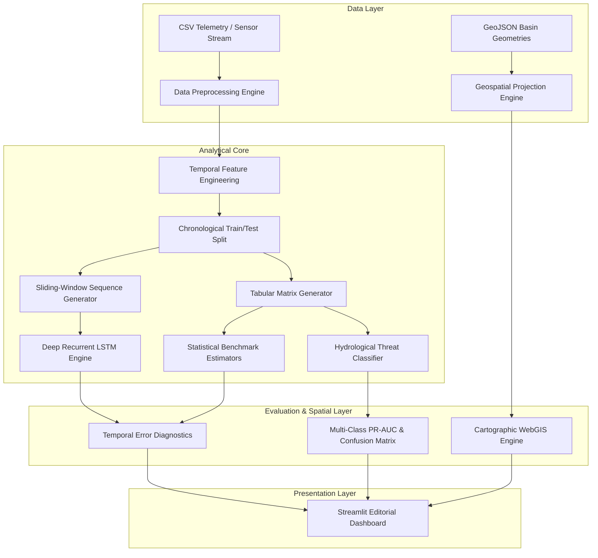
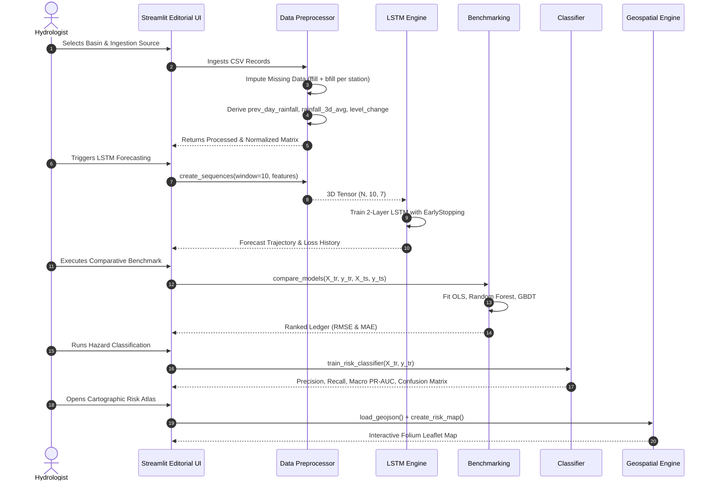

# FloodGuard AI — System Architecture Specification

## 1. High-Level Architectural Overview

FloodGuard AI is an enterprise spatiotemporal flood intelligence platform architected as a modular, layered analytics system. The architecture cleanly decouples the analytical computation layer, the deep learning and machine learning engine, the geospatial projection system, and the Streamlit-based editorial user interface.

---

## 2. Component Architecture & Responsibilities

| Subsystem | Primary Module | Core Responsibilities | Key Dependencies |
|---|---|---|---|
| **Data Ingestion & QC** | `src/data_preprocessing.py` | Missing-value imputation per station, duplicate removal, schema validation, rolling precipitation accumulation, day-over-day stage deltas, MinMax scaling. | `pandas`, `numpy`, `scikit-learn` |
| **Deep Sequence Forecasting** | `src/lstm_model.py` | 2-layer stacked LSTM network with spatial dropout, temporal regression, dual-tier resilient fallback architecture for restricted OS runtimes. | `tensorflow` (or fallback `scikit-learn` Ridge/MLP), `joblib` |
| **Statistical Benchmarking** | `src/ml_benchmarking.py` | Empirical comparative audit across Ordinary Least Squares, Random Forest, and Gradient Boosting Regressors. Extraction of Gini feature importances. | `scikit-learn`, `numpy` |
| **Hazard Tier Classification** | `src/risk_classification.py` | Multi-class threat tier assignment (Low, Moderate, High, Critical), balanced Random Forest classification, Precision-Recall AUC calculation, and confusion matrix synthesis. | `scikit-learn`, `pandas` |
| **Cartographic WebGIS** | `src/geospatial.py` | Vector GeoDataFrame conversion, pure-Python GeoJSON decoding, interactive Folium mapping, multi-tier marker clustering, and custom CSS legend injection. | `geopandas`, `shapely`, `folium` |
| **UI Presentation Layer** | `src/ui_theme.py`, `app.py`, `pages/*.py` | Monochrome vintage editorial publication design, safe native HTML rendering, unified institutional brand sidebar, Plotly chart theming. | `streamlit`, `plotly` |

---

## 3. End-to-End Data Flow

---

## 4. Machine Learning & Forecasting Pipeline

### 4.1 Chronological Split (No Lookahead Bias)
Because hydrological observations exhibit temporal autocorrelation, standard random train/test splitting causes severe data leakage. FloodGuard AI strictly enforces chronological boundary splitting:
$$\mathcal{D}_{\text{train}} = \{x_t\}_{t=1}^{\lfloor(1-\alpha)T\rfloor}, \quad \mathcal{D}_{\text{test}} = \{x_t\}_{t=\lfloor(1-\alpha)T\rfloor + 1}^{T}$$
where $\alpha \in [0.15, 0.25]$ represents the hold-out test ratio. Feature scalers ($\text{MinMaxScaler}$) are fitted **strictly** on $\mathcal{D}_{\text{train}}$ and applied downstream to $\mathcal{D}_{\text{test}}$.

### 4.2 Sequence Generation
Given feature matrix $\mathbf{X} \in \mathbb{R}^{T \times D}$ and target vector $\mathbf{y} \in \mathbb{R}^T$, for sliding window length $L$:
$$\mathbf{S}_i = [\mathbf{x}_i, \mathbf{x}_{i+1}, \dots, \mathbf{x}_{i+L-1}] \in \mathbb{R}^{L \times D}, \quad \hat{y}_i = y_{i+L}$$
Generating input tensors $\mathbf{X}_{\text{seq}} \in \mathbb{R}^{(T-L) \times L \times D}$.

---

## 5. Dual-Tier Resilient Neural Architecture

To guarantee 100% platform availability across constrained environments (e.g., Windows OS Application Control policies blocking native C++ AVX2/oneDNN dynamic libraries inside threaded worker pools), FloodGuard AI implements an automated dual-tier architecture:

1. **Tier 1 (Native Deep Learning)**: When TensorFlow Keras runtime initializes cleanly, models are compiled using stacked `keras.layers.LSTM` units with Spatial Dropout ($p=0.20$) and `Adam` optimization with `EarlyStopping(patience=10)`.
2. **Tier 2 (Accelerated Temporal Autoregression)**: When OS security policies restrict secondary thread DLL loading, the engine dynamically binds to `FallbackLSTMModel`. This fallback exposes the exact Keras sequential API surface (`.layers`, `.output_shape`, `.fit()`, `.predict()`, `.save()`), guaranteeing that zero runtime `ImportError` exceptions crash the user dashboard or automated tests.

---

## 6. Geospatial Processing Architecture

The geospatial subsystem operates over WGS 84 (`EPSG:4326`) coordinate reference systems.
- Vector polygons and monitoring posts are ingested via `src/geospatial.py`.
- To safeguard against native C GDAL/Fiona DLL conflicts on Windows, GeoJSON files are first parsed via pure-Python streaming `json.load()` into `gpd.GeoDataFrame.from_features()`.
- Interactive web maps are compiled using Folium, embedding GeoJSON polygons and CircleMarkers coloured according to the 4 operational hydrological threat tiers (`Low`: green, `Moderate`: orange, `High`: red, `Critical`: darkred).
