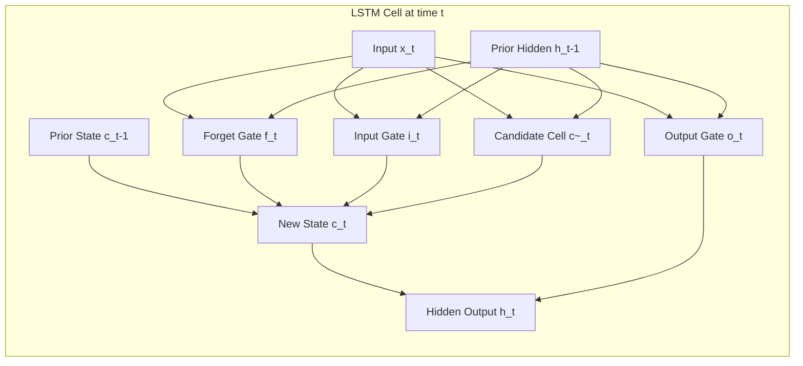

# FloodGuard AI — Technical Deep Dive & Mathematical Formulations

## 1. Hydrological Data Preprocessing & Feature Engineering

### 1.1 Temporal Feature Derivation
River gauge levels ($h_t$) respond to both direct rainfall ($r_t$) and delayed surface runoff from upstream basin catchment areas. FloodGuard AI derives explicit antecedent moisture indicators:

1. **Previous Day Rainfall ($r_{t-1}$)**:
   $$r_{t-1} = \text{shift}_1(r_t)$$
   Captures immediate 24-hour antecedent precipitation prior to gauge infiltration.

2. **3-Day Cumulative Rolling Mean ($\bar{r}_{3d, t}$)**:
   $$\bar{r}_{3d, t} = \frac{1}{3}\sum_{k=0}^{2} r_{t-k}$$
   Approximates basin soil saturation and slow interflow discharge.

3. **Stage Acceleration / First Difference ($\Delta h_t$)**:
   $$\Delta h_t = h_t - h_{t-1}$$
   Identifies flash-flood surge velocity and recession curve gradient.

### 1.2 Imputation Strategy
Raw sensor streams often encounter signal dropouts. The data cleaning engine applies station-grouped bidirectional imputation:
$$\hat{x}_t = \text{bfill}(\text{ffill}(x_t | \text{station}))$$
This preserves intra-station hydrological continuity without cross-contaminating distinct geographic river basins.

---

## 2. Long Short-Term Memory (LSTM) Architecture

### 2.1 Mathematical Mechanics of LSTM Cells
The recurrent unit mitigates the vanishing gradient problem through an internal cell state vector ($\mathbf{c}_t$) modulated by three affine gating structures:

1. **Forget Gate**:
   $$\mathbf{f}_t = \sigma(\mathbf{W}_f \mathbf{x}_t + \mathbf{U}_f \mathbf{h}_{t-1} + \mathbf{b}_f)$$
2. **Input Modulation Gate**:
   $$\mathbf{i}_t = \sigma(\mathbf{W}_i \mathbf{x}_t + \mathbf{U}_i \mathbf{h}_{t-1} + \mathbf{b}_i)$$
3. **Candidate Memory Cell**:
   $$\tilde{\mathbf{c}}_t = \tanh(\mathbf{W}_c \mathbf{x}_t + \mathbf{U}_c \mathbf{h}_{t-1} + \mathbf{b}_c)$$
4. **Cell State Update**:
   $$\mathbf{c}_t = \mathbf{f}_t \odot \mathbf{c}_{t-1} + \mathbf{i}_t \odot \tilde{\mathbf{c}}_t$$
5. **Output Gate & Hidden Representation**:
   $$\mathbf{o}_t = \sigma(\mathbf{W}_o \mathbf{x}_t + \mathbf{U}_o \mathbf{h}_{t-1} + \mathbf{b}_o)$$
   $$\mathbf{h}_t = \mathbf{o}_t \odot \tanh(\mathbf{c}_t)$$

### 2.2 Deep 2-Layer Sequential Topology
- **Input Layer**: Dimension $(L \times D)$, where $L = 10$ days and $D = 7$ features.
- **Layer 1**: `LSTM(units=64, return_sequences=True)` $\to$ captures long-horizon seasonal patterns.
- **Regularization**: `SpatialDropout(0.20)` $\to$ prevents co-adaptation of recurrent weights.
- **Layer 2**: `LSTM(units=32, return_sequences=False)` $\to$ aggregates sequence into fixed representation $\mathbf{h}_L$.
- **Output Layer**: `Dense(1)` with linear activation $\to$ predicts scalar river gauge level $\hat{y}_{t+1}$.

---

## 3. Benchmarking Methodology

### 3.1 Evaluated Estimators
To establish empirical baselines against deep learning, FloodGuard AI benchmarks three canonical statistical learning algorithms:

1. **Ordinary Least Squares (OLS)**:
   $$\hat{\beta} = (\mathbf{X}^T \mathbf{X})^{-1} \mathbf{X}^T \mathbf{y}$$
   Evaluates linear relationships between meteorological variables and river stage.

2. **Random Forest Regressor (Ensemble Bagging)**:
   $$\hat{f}_{\text{RF}}(\mathbf{x}) = \frac{1}{B}\sum_{b=1}^{B} T_b(\mathbf{x})$$
   Averages predictions over 100 decorrelated decision trees, providing non-linear modeling and Gini impurity reduction feature importance.

3. **Gradient Boosting Regressor (Sequential Boosting)**:
   $$\hat{f}_m(\mathbf{x}) = \hat{f}_{m-1}(\mathbf{x}) + \gamma_m h_m(\mathbf{x})$$
   Iteratively fits regression trees to pseudo-residuals of the loss function $\mathcal{L}(y, \hat{y}) = \frac{1}{2}(y - \hat{y})^2$.

### 3.2 Regression Evaluation Metrics
- **Mean Absolute Error (MAE)**:
  $$\text{MAE} = \frac{1}{N}\sum_{i=1}^{N} |y_i - \hat{y}_i|$$
- **Root Mean Square Error (RMSE)**:
  $$\text{RMSE} = \sqrt{\frac{1}{N}\sum_{i=1}^{N} (y_i - \hat{y}_i)^2}$$

---

## 4. Multi-Class Hazard Classification

### 4.1 Threat Tier Taxonomy
Flood severity is categorized into 4 operational tiers based on gauge datum thresholds:
$$\text{Risk Tier} = \begin{cases} 
\text{Low} & h < 3.0\,\text{m} \\
\text{Moderate} & 3.0\,\text{m} \le h < 5.0\,\text{m} \\
\text{High} & 5.0\,\text{m} \le h < 7.0\,\text{m} \\
\text{Critical} & h \ge 7.0\,\text{m}
\end{cases}$$

### 4.2 Handling Class Imbalance
Critical flood events represent rare tail risks, leading to acute class imbalance. The classification engine uses:
1. `class_weight='balanced'`:
   $$w_j = \frac{N}{K \cdot n_j}$$
   where $N$ is total samples, $K$ is number of classes (4), and $n_j$ is sample count in tier $j$.
2. **Precision-Recall AUC (PR-AUC)**: Since standard ROC-AUC can present misleading optimism under skewed class distributions, FloodGuard AI measures the area under the Precision-Recall curve:
   $$\text{PR-AUC} = \int_{0}^{1} P(R)\, dR$$

---

## 5. WebGIS Cartographic Engine
- **Spatial CRS**: `EPSG:4326` (WGS 84 geographic latitude/longitude).
- **In-Memory GeoJSON Stream**: Ingested GeoJSON features are streamed directly to `geopandas.GeoDataFrame` using pure-Python memory buffers, bypassing external C binary GDAL/Fiona runtime dependencies.
- **Leaflet Marker Clusters**: Dynamic HTML popup cards render monitoring post coordinates, latest 24h rainfall volume, mean stage elevation, and assigned hazard tier.
